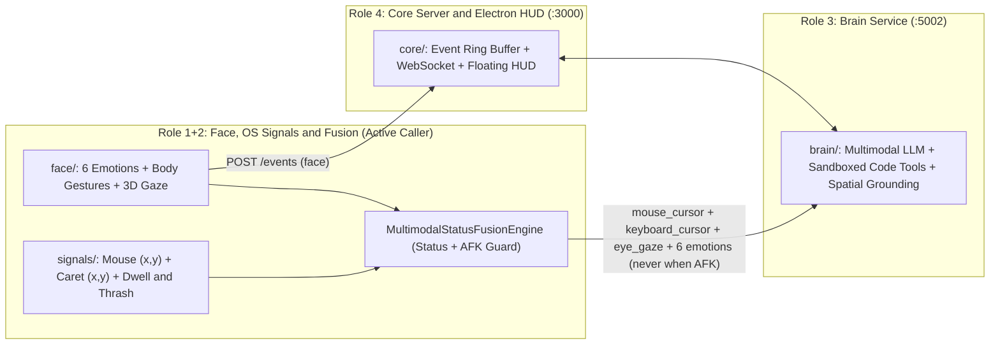

# WHACK

A privacy-first, multimodal developer assistant that fuses **real-time facial affect, upper-body/hand gestures, 6-DOF 3D eye-gaze tracking, and OS mouse/caret behavioral signals** to detect when a developer is genuinely stuck — actively triggering grounded codebase hints without interrupting flow or away-from-keyboard breaks.

---

## System Architecture



---

## Repository Structure

```text
WHACK/
├── README.md
├── agent.md                             # Multi-agent orchestration overview
├── docs/agents/
│   ├── AGENT_ROLE1_FACE_FUSION.md       # Combined Role 1+2: Face, Signals & Fusion spec
│   ├── AGENT_ROLE3_BRAIN.md             # Role 3: Brain LLM & spatial diagnosis spec
│   └── AGENT_ROLE4_FRONTEND_CORE.md     # Role 4: Core server, contracts & Electron HUD spec
│
├── face/                                # Role 1+2: Webcam affect, body gestures & 3D gaze
│   ├── environment.yml                  # Conda env (whack-face, Python 3.11)
│   ├── model_loader.py                  # Auto-downloads MediaPipe Face/Pose/Hand .task models
│   ├── eyeball_tracker.py               # 6-DOF 3D eyeball ray-plane + VOR head-turn solver
│   ├── gaze_tracker.py                  # Screen pixel gaze, blink rate & 1-Euro filtering
│   ├── body_gesture_tracker.py          # Head scratch, chin rest, facepalm, shrug, nod/shake
│   ├── emotion_detector.py              # 6 calibrated emotions + talking suppression guard
│   ├── calibration.py                   # 5s neutral baseline + 9-pt/VOR 3D gaze profile
│   ├── prototype_gui.py                 # Standalone Face + 3D Gaze calibration GUI
│   ├── mock_emitter.py                  # Live / synthetic Face event emitter -> Core :3000
│   └── self_test.py                     # Automated Face + 3D Gaze test suite
│
├── signals/                             # Role 1+2: OS signals, status fusion & Brain caller
│   ├── input_caret_tracker.py           # DPI-aware Win32 mouse (x,y), Caret | (x,y), typo-safe thrash
│   ├── status_fusion.py                 # Signal + Facial User Status engine & anti-false-AFK guards
│   ├── brain_caller.py                  # Active 3-coord + 6-emotion Brain caller & stub adapter
│   ├── prototype_signals_gui.py         # Unified Camera + 3-Coord Radar + Sandbox + Brain GUI
│   └── self_test.py                     # Automated Signals + Fusion + Brain Caller test suite
│
├── brain/                               # Role 3: FastAPI (:5002) multimodal diagnosis & tools
├── core/                                # Role 4: Node/TS Core Server (:3000) & Electron HUD
├── demo-repo/ & demo-repo-stages/       # Planted bug stages & ablation scenarios
└── tools/                               # Async agent board & demo/ablation utilities
```

---

## Role 1+2: Face, OS Signals & Multimodal Fusion (`face/` + `signals/`)

### 1. Real-Time Affect, Body Gestures & 3D Eyeball Gaze (`face/`)
Runs 100% locally on CPU (`~30 FPS`) with **zero raw video frames saved or transmitted**:
- **6 Calibrated Affective States**: `confused`, `frustrated`, `surprised`, `flow`, `fatigued`, and `delighted` — calibrated against a 5-second personal neutral baseline (`[C]`) with CLAHE illumination normalization and EMA smoothing.
- **Upper-Body & Hand Gesture Tracking**: Detects `head_scratch`, `chin_rest`, `facepalm_or_rub`, `hands_thrown_up`, `clenched_fist`, `thumbs_up`, rhythmic `head_nod` / `head_shake`, shoulder shrug, and forward screen lean.
- **6-DOF Head-Invariant 3D Eyeball Gaze (`v4`)**: Reconstructs left/right 3D eyeball centers in skull coordinates, applies anatomical optic-to-visual $\kappa$-angle offsets, intersects binocular gaze rays with a tilted monitor plane, and supports 10-step **9-Point + VOR Head-Turn Lock** calibration (`[G]`).

### 2. Privacy-Safe OS Telemetry & Typo-Safe Thrash Detection (`signals/input_caret_tracker.py`)
Tracks physical screen coordinates without ever logging alphanumeric keystrokes or source text:
- **`mouse_cursor (x, y)`**: Win32 `GetCursorPos` (DPI-aware), idle/dwell duration, velocity, and rapid **mouse frustration wiggle** detection.
- **`keyboard_cursor | (x, y)`**: Tracks the vertical text insertion caret across external apps (Win32 `GetGUIThreadInfo` + MSAA `oleacc.dll` `OBJID_CARET` for VS Code/Chrome/Notepad) plus the built-in sandbox editor.
- **Typo vs. Stuck Rewrite Disambiguation**: Collapses rapid `< 2.0s` `Backspace` bursts into a **single typo episode** (ignored when typing resumes), while flagging genuine stuck rewrites via cognitive hesitation pauses (`1.2s–12s`), `Ctrl+Z` $\leftrightarrow$ `Ctrl+Y` flip-flops, and same-line Y-band trapping (`>= 3` episodes with facial distress, or `>= 5` poker-face episodes).

### 3. Unified User Status & Active Brain Caller (`signals/status_fusion.py`, `signals/brain_caller.py`)
Fuses OS signals + 3D gaze + 6 emotions into a unified status with strict anti-annoyance guards:
- **Statuses**: `focused_flow` (Do-Not-Disturb), `calm_reading`, `confused_thinking` (confirming dwell), `afk_away`, `talking_suppressed`, `fatigued`, `eureka_resolved`, and actionable stuck states (`stuck_frozen_at_caret`, `stuck_erase_thrash`, `stuck_attention_split`, `frustrated_blocked`).
- **Anti-False-AFK Confusion Fix**: Clamps off-bezel squint/brow-furrow/chin-tuck gaze drift back on-screen whenever the user faces the desk (`|head_yaw| < 50°`) with active confusion, and holds face state through `< 3.0s` hand-occlusion frames (`head_scratch` / `facepalm`). True `afk_away` requires cursors idle `>= 8s` plus continuous absence (`>= 3s` no face) or sustained sideways head turn (`>= 45°` for `>= 4s`) without confusion.
- **4 Mandatory Brain Inputs (Never Called When AFK)**: Whenever an actionable stuck state holds past confirmation (and `status != "afk_away"`), `ActiveBrainCaller` dispatches:
  1. `mouse_cursor`: `{"x": mouse_x_px, "y": mouse_y_px}` (and `cursorScreenPos: [x, y]`)
  2. `keyboard_cursor`: `{"x": caret_x_px, "y": caret_y_px, "detected": bool}` (and `caretScreenPos: [x, y]`)
  3. `eye_gaze`: `{"x": gaze_x_px, "y": gaze_y_px, "zone": str}` (and `gazePoint: [x, y]`)
  4. `emotions`: all **6** calibrated scores (`confused`, `frustrated`, `surprised`, `flow`, `fatigued`, `delighted`)

---

## Quickstart & Running Each Component

### 1. Setup & Run Combined Face + Signals Prototype (`face/` + `signals/`)
```powershell
# Create unified Conda environment (one-time)
conda env create -f face/environment.yml

# Launch Unified Signal + Facial Status & Active Brain Caller GUI
C:\Users\davec\anaconda3\envs\whack-face\python.exe signals/prototype_signals_gui.py

# Or launch standalone Face + 3D Eyeball Gaze GUI
C:\Users\davec\anaconda3\envs\whack-face\python.exe face/prototype_gui.py

# Run automated verification suites
C:\Users\davec\anaconda3\envs\whack-face\python.exe face/self_test.py
C:\Users\davec\anaconda3\envs\whack-face\python.exe signals/self_test.py
```
**GUI Shortcuts (`signals/prototype_signals_gui.py`)**:
- `[C]`: 5-second neutral face calibration
- `[G]`: 10-step 3D gaze + VOR head-turn calibration
- `[O]`: Toggle click-through desktop overlay dots (cyan gaze ring + amber `|` caret)
- `[B]`: Toggle live HTTP `POST` to Role 3 Brain (`http://localhost:5002/diagnose`)
- `[F]`: Force test Brain call (automatically blocked if `AFK`)
- `[R]`: Reset trigger cooldown

### 2. Run Brain Diagnosis Server (`brain/`, Role 3)
```bash
python -m brain.server --port 5002
```
See [`brain/README.md`](brain/README.md) for sandboxed codebase tools, spatial `[y, x]` normalization, and offline/Gemini modes.

### 3. Run Core Server & Electron Floating HUD (`core/`, Role 4)
```bash
cd core
npm install
npm run dev:electron
```
See [`core/README.md`](core/README.md) for WebSocket event streaming, global `Ctrl+Shift+K` shortcut, and simulator scripts.

---

## Team Roles & Ownership

| Role | Handle | Directories | Scope |
| :--- | :--- | :--- | :--- |
| **Role 1+2 (Combined)** | `@face-fusion-lead` (`@signals-lead`) | `face/`, `signals/` | Webcam 6-emotion & gesture detection, 6-DOF 3D gaze, Win32 mouse/caret tracking, status fusion, and active 4-input Brain caller. |
| **Role 3** | `@brain-lead` | `brain/`, `demo-repo/` | Multimodal LLM diagnosis, spatial coordinate grounding, sandboxed code inspection tools, and progressive hints (`nudge` / `hint` / `full_explanation`). |
| **Role 4 (Lead)** | `@frontend-core` | `core/` | Shared contracts, Core HTTP/WebSocket server (`:3000`), and Electron Paper & Carbon floating HUD. |
