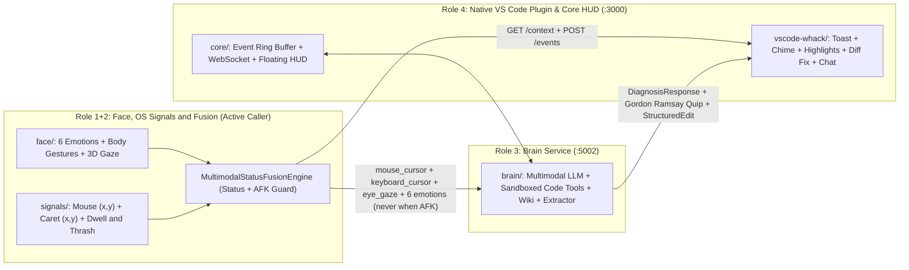

# WHACK

A privacy-first, real-time multimodal developer assistant that fuses **live facial affect, upper-body/hand gestures, 6-DOF 3D eye-gaze tracking, and OS mouse/caret behavioral signals** to detect when a developer is genuinely stuck — proactively triggering Gordon Ramsay-styled, line-cited codebase diagnostics and 1-click fixes in VS Code without interrupting flow or away-from-keyboard breaks.

---

## System Architecture



---

## Repository Structure

```text
WHACK/
├── README.md
├── agent.md                             # Multi-agent orchestration overview
├── docs/agents/
│   ├── AGENT_ROLE1_FACE_FUSION.md       # Combined Role 1+2: Face, Signals & Fusion spec
│   ├── AGENT_ROLE3_BRAIN.md             # Role 3: Brain LLM & spatial diagnosis spec
│   └── AGENT_ROLE4_FRONTEND_CORE.md     # Role 4: Core server, contracts & Electron HUD spec
│
├── face/                                # Role 1+2: Webcam affect, body gestures & 3D gaze
│   ├── environment.yml                  # Conda env (whack-face, Python 3.11)
│   ├── model_loader.py                  # Auto-downloads MediaPipe Face/Pose/Hand .task models
│   ├── eyeball_tracker.py               # 6-DOF 3D eyeball ray-plane + VOR head-turn solver
│   ├── gaze_tracker.py                  # Screen pixel gaze, blink rate & 1-Euro filtering
│   ├── body_gesture_tracker.py          # Head scratch, chin rest, facepalm, shrug, nod/shake
│   ├── emotion_detector.py              # 6 calibrated emotions + talking suppression guard
│   ├── calibration.py                   # 5s neutral baseline + 9-pt/VOR 3D gaze profile
│   ├── prototype_gui.py                 # Standalone Face + 3D Gaze calibration GUI
│   ├── mock_emitter.py                  # Live telemetry emitter -> :3000/events
│   └── self_test.py                     # Automated Face + 3D Gaze test suite
│
├── signals/                             # Role 1+2: OS signals, status fusion & Brain caller
│   ├── input_caret_tracker.py           # DPI-aware Win32 mouse (x,y), Caret | (x,y), typo-safe thrash
│   ├── status_fusion.py                 # Signal + Facial User Status engine & anti-false-AFK guards
│   ├── brain_caller.py                  # Live 3-coord + 6-emotion Brain HTTP caller (:5002)
│   ├── prototype_signals_gui.py         # Unified Camera + 3-Coord Radar + Sandbox + Brain GUI
│   └── self_test.py                     # Automated Signals + Fusion + Brain Caller test suite
│
├── brain/                               # Role 3: FastAPI (:5002) multimodal LLM diagnosis, extractor & wiki
├── vscode-whack/                        # Role 4: Native VS Code plugin (toast, highlights, diff fix & chat)
├── core/                                # Role 4: Node/TS Core Server (:3000) & Electron HUD
├── demo-repo/ & demo-repo-stages/       # Planted bug stages & ablation scenarios
└── tools/                               # Git post-commit wiki hook installer, demo & ablation utilities
```

---

## Role 1+2: Face, OS Signals & Multimodal Fusion (`face/` + `signals/`)

### 1. Real-Time Affect, Body Gestures & 3D Eyeball Gaze (`face/`)
Runs 100% locally on CPU (`~30 FPS`) with **zero raw video frames saved or transmitted**:
- **6 Calibrated Affective States**: `confused`, `frustrated`, `surprised`, `flow`, `fatigued`, and `delighted` — calibrated against a 5-second personal neutral baseline (`[C]`) with CLAHE illumination normalization and EMA smoothing.
- **Upper-Body & Hand Gesture Tracking**: Detects `head_scratch`, `chin_rest`, `facepalm_or_rub`, `hands_thrown_up`, `clenched_fist`, `thumbs_up`, rhythmic `head_nod` / `head_shake`, shoulder shrug, and forward screen lean.
- **6-DOF Head-Invariant 3D Eyeball Gaze (`v4`)**: Reconstructs left/right 3D eyeball centers in skull coordinates, applies anatomical optic-to-visual $\kappa$-angle offsets, intersects binocular gaze rays with a tilted monitor plane, and supports 10-step **9-Point + VOR Head-Turn Lock** calibration (`[G]`).

### 2. Privacy-Safe OS Telemetry & Typo-Safe Thrash Detection (`signals/input_caret_tracker.py`)
Tracks physical screen coordinates without ever logging alphanumeric keystrokes or source text:
- **`mouse_cursor (x, y)`**: Win32 `GetCursorPos` (DPI-aware), idle/dwell duration, velocity, and rapid **mouse frustration wiggle** detection.
- **`keyboard_cursor | (x, y)`**: Tracks the vertical text insertion caret across external apps (Win32 `GetGUIThreadInfo` + MSAA `oleacc.dll` `OBJID_CARET` for VS Code/Chrome/Notepad) plus the built-in sandbox editor.
- **Typo vs. Stuck Rewrite Disambiguation**: Collapses rapid `< 2.0s` `Backspace` bursts into a **single typo episode** (ignored when typing resumes), while flagging genuine stuck rewrites via cognitive hesitation pauses (`1.2s–12s`), `Ctrl+Z` $\leftrightarrow$ `Ctrl+Y` flip-flops, and same-line Y-band trapping (`>= 3` episodes with facial distress, or `>= 5` poker-face episodes).

### 3. Unified User Status & Active Brain Caller (`signals/status_fusion.py`, `signals/brain_caller.py`)
Fuses OS signals + 3D gaze + 6 emotions into a unified status with strict anti-annoyance guards:
- **Statuses**: `focused_flow` (Do-Not-Disturb), `calm_reading`, `confused_thinking` (confirming dwell), `afk_away`, `talking_suppressed`, `fatigued`, `eureka_resolved`, and actionable stuck states (`stuck_frozen_at_caret`, `stuck_erase_thrash`, `stuck_attention_split`, `frustrated_blocked`).
- **Anti-False-AFK & No-Camera Safety**: Clamps off-bezel squint/brow-furrow/chin-tuck gaze drift back on-screen whenever the user faces the desk (`|head_yaw| < 50°`) with active confusion, holds face state through `< 3.0s` hand-occlusion frames, and marks idle no-camera sessions as `afk_away` rather than false-triggering.
- **Live Brain & VS Code Context Integration (Never Called When AFK)**: Queries `GET http://127.0.0.1:3000/context` to respect VS Code snooze/pause and attach the active workspace `repoPath`, `editorState`, and `terminalState`, then dispatches `mouse_cursor`, `keyboard_cursor`, `eye_gaze`, and all **6** emotion scores to `POST http://127.0.0.1:5002/diagnose`.

---

## Quickstart & Running the Full Pipeline

### 1. Configure & Start Brain Server (`brain/`, `:5002`)
```powershell
# Copy brain/.env.example -> brain/.env and set GEMINI_API_KEY (or OPENAI_API_KEY / ANTHROPIC_API_KEY)
python -m brain.server --port 5002
```

### 2. Install or Launch Native VS Code Plugin (`vscode-whack/`)
- Install `vscode-whack/whack-vscode-0.1.0.vsix` via **Extensions (`Ctrl+Shift+X`) -> `⋯` -> `Install from VSIX...`** (or press **`F5`** in VS Code).
- Press **`Ctrl+Shift+K`** to request a live diagnosis anytime, or let `signals` trigger it proactively in the moment!

### 3. Launch Live Face + Signals Tracker (`face/` + `signals/`)
```powershell
# Create unified Conda environment (one-time)
conda env create -f face/environment.yml

# Launch Unified Signal + Facial Status & Active Brain Caller GUI (HTTP :5002 ON by default)
python signals/prototype_signals_gui.py

# Run automated verification suites
python face/self_test.py
python signals/self_test.py
pytest brain/tests -v
```

### 4. Automatic Local Architecture Wiki on `git commit`
```powershell
# Install the post-commit hook on WHACK (and ~/whack-demo-repo if present)
python tools/install_git_hooks.py
```
Every `git commit` automatically refreshes `<repo>/.whack/WIKI.md` (excluded from `git status`) with AST symbols, module overviews, and `HEAD` commit activity.

---

## Team Roles & Ownership

| Role | Handle | Directories | Scope |
| :--- | :--- | :--- | :--- |
| **Role 1+2 (Combined)** | `@face-fusion-lead` (`@signals-lead`) | `face/`, `signals/` | Webcam 6-emotion & gesture detection, 6-DOF 3D gaze, Win32 mouse/caret tracking, status fusion, and live Brain HTTP caller. |
| **Role 3** | `@brain-lead` | `brain/`, `demo-repo/` | Multimodal LLM tool loop, Gordon Ramsay persona, resilient output extraction, dynamic workspace tools, and auto-updating local wiki. |
| **Role 4 (Lead)** | `@frontend-core` | `vscode-whack/`, `core/` | Native VS Code plugin (toast, chime, highlights, 1-click diff fix, `/chat`), shared contracts, Core server (`:3000`), and Electron HUD. |
